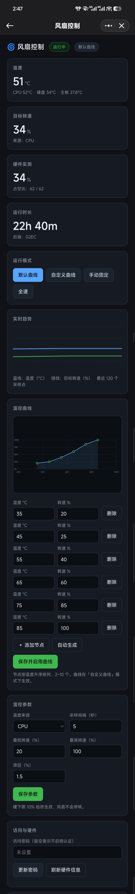

# 风扇控制（g2fan）— 拾光坞 G2 风扇转速控制

面向**拾光坞 G2（Intel N150）+ 飞牛 fnOS** 的风扇控制工具，打包为 `.fpk`，
可直接在飞牛应用中心手动安装。

**核心：原生驱动 G2 的 EC 风扇控制器，不依赖厂商二进制，不依赖第三方 Python 包。**

## 界面预览



---

## 功能

- 原生驱动拾光坞 G2 内置 EC，不依赖厂商二进制
- 温控曲线自动调速，支持手动固定与全速模式
- 多层安全保护：失控兜底、退出还原、EC 回读校验
- Web 管理界面：实时温度、转速、趋势图与曲线编辑
- 温度来源可选 CPU / 硬盘 / 主板，支持传感器自动发现

## 更新日志

| 版本 | 说明 |
| --- | --- |
| **1.0.0** | 首个公开版本：原生 EC 风扇调速、温控曲线、手动/全速模式、多层安全保护与 Web 管理界面。 |

---

## 为什么需要它

拾光坞 G2 出厂系统内置风扇阶梯调速，但**刷第三方系统（含 fnOS）后自动调速失效**，
双风扇之一会持续 100% 全速，噪音明显（这一点拾光坞官方在降噪教程中也确认过）。

G2 的风扇**不受标准 Linux hwmon 驱动管辖**，因此：

- `sensors` / `pwmconfig` 看不到任何风扇；
- `/sys/class/hwmon/*/` 下**没有 `pwm*` 节点**；
- 社区通用方案（ITE/Nuvoton/Fintek hwmon 调 PWM）在 G2 上**无效**。

风扇挂在内嵌控制器（EC）上，只能通过裸 I/O 端口访问 EC RAM。

## 硬件协议（本项目的技术核心）

> 结论来自对拾光坞官方 `fanctrl`（`http://down.sgwbox.com/tools/x86/fanctrl`）
> 的静态反汇编 **与** 经验性端口写入捕获，两者交叉验证一致，非猜测。

访问通道：`/dev/port`（内核需 `CONFIG_DEVPORT=y`，本机 `6.18.18.c1126-trim` 已启用）。

- 端口 `0x4E` = 命令/索引口，端口 `0x4F` = 数据口
- 一次 EC RAM 访问 = 5 组 (寄存器, 数据) 对共 10 次端口写（地址选择），
  再用命令 `0x2F` 打开数据窗口，最后写或读数据口

```
0x4E <- 0x2E   0x4F <- 0x11      # 地址高字节窗口
0x4E <- 0x2F   0x4F <- addr_hi
0x4E <- 0x2E   0x4F <- 0x10      # 地址低字节窗口
0x4E <- 0x2F   0x4F <- addr_lo
0x4E <- 0x2E   0x4F <- 0x12      # 选择数据窗口
0x4E <- 0x2F                     # 打开数据窗口 —— 写和读都必须有这一步
   写：0x4F <- value             #   合计 12 次端口写
   读：inb(0x4F)                #   合计 11 次端口写 + 1 次端口读
```

> **踩坑记录（真机实测）**：最初实现漏掉了「打开数据窗口」这一步，结果读任何
> 寄存器都返回选择序列末尾写入的 `0x12` —— 表现为 `0x2F1` / `0x1807` / `0x1809`
> **全部等于 0x12**。风扇写入调速不受影响（写路径正确），但寄存器回读与
> 「接管前快照」全部失真，退出时会把错误值写回 EC。当前版本已修复，
> 并在还原后增加回读校验，校验不过则退回全速兜底。
> `--probe` 会把上述哨兵特征作为自检项报告出来。

风扇寄存器：

| 寄存器 | 写入值 | 含义 |
| --- | --- | --- |
| `0x2F1` | `0xAA` | 切换到 EC 手动调速（覆盖固件自动曲线） |
| `0x1807` | duty | 风扇 1 占空比 |
| `0x1809` | duty | 风扇 2 占空比 |

占空比范围 `0..184`（`0xB8`），百分比换算 **截断**：

```
duty = min(int(speed / 100 * 184), 184)
```

实测对照（与厂商工具逐字节一致）：

| 输入 | 写入 `0x1807/0x1809` | 验算 |
| --- | --- | --- |
| 30 | `0x37` = 55 | ⌊30/100×184⌋ = 55 |
| 50 | `0x5C` = 92 | ⌊50/100×184⌋ = 92 |
| 100 | `0xB8` = 184 | 184 |

设置一次转速的完整动作：

```
open("/dev/port", O_RDWR)
ec_write(0x2F1, 0xAA)      # 接管
ec_write(0x1807, duty)     # 风扇 1
ec_write(0x1809, duty)     # 风扇 2
```

安装后可用 `g2fan-run.py --probe` 只读验证通道是否可用。

## 功能细节

- **四种模式**：默认曲线（内置保守曲线）、自定义曲线、手动固定转速、全速
- **温控曲线**：2–10 个节点，线性插值，网页可视化编辑 + 一键自动生成
- **温度来源**：CPU（coretemp / k10temp / zenpower）、硬盘（drivetemp / nvme）、两者最高值
- **Web 管理界面**：实时温度/转速、趋势图、曲线编辑器、事件日志、可选密码认证
- **REST API**：便于脚本化集成
- **通用回退**：若目标机器有标准 hwmon PWM（ITE/Nuvoton/Fintek），自动改用 hwmon 后端

## 安全设计

硬件控制程序出问题的代价很高，因此安全机制是一等公民：

| 机制 | 触发条件 | 动作 |
| --- | --- | --- |
| 硬下限 | 始终生效 | 转速绝不低于 **10%**，风扇不会停转 |
| 温度读取失败 | 连续 3 次 | 立即 100% 散热 |
| 温度持续失败 | 连续 5 次 | 降级到 default 模式并告警 |
| 写入失败 | 连续 3 次 | 标记 degraded 并记录 |
| 看门狗 | 控制循环心跳超时 | 独立线程直接写 100% |
| 退出还原 | 服务停止 / 卸载 | 还原接管前 EC 寄存器快照 |
| **崩溃还原** | 进程被 SIGKILL | 快照已落盘，`cmd/main stop` 自动用 `--release` 兜底还原 |

**权限模型**：`/dev/port` 是 `root:kmem 0640`，打开它需要特权。因此应用以 root 启动，
**打开设备后立即降权到 fnOS 包用户**，Web 服务与配置读写都以非 root 身份运行。
root 只在启动初期存在。若你更希望完全不使用 root，可把 `config/privilege` 改为：

```json
{ "defaults": { "run-as": "package" }, "join-groups": ["kmem"] }
```

## 安装

### 方式一：应用中心（推荐）

1. 飞牛桌面 → **应用中心** → 右上角 **手动安装**
2. 选择 `g2fan.fpk`
3. 选择安装卷，完成向导（可设置访问密码、默认模式）
4. 安装完成后点击桌面图标「风扇控制」，或访问 `http://<NAS地址>:8798/`

### 方式二：命令行

```bash
appcenter-cli install-fpk g2fan.fpk -v 1
```

### 运行前提

- fnOS x86 平台，系统版本 ≥ 1.2.0
- Python 3.8+。fnOS 基础系统自带 `/usr/bin/python3`（Debian 12 / 3.11）；
  若你的系统没有，请在应用中心安装 `python312`，程序会自动优先使用它。

## 安装后验证

```bash
# 1) 只读探测：确认 EC 通道与温度传感器可用（需 root）
sudo python3 /var/apps/g2fan/target/server/g2fan-run.py --probe
```

关注输出中的 `ec.accessible` 与 `ec.enable`。正常应看到
`"accessible": true` 且 `enable` 有数值。

```bash
# 2) 查看运行日志（默认曲线下应能看到温度 -> 转速的变化）
cat /vol1/@appdata/g2fan/fan.log

# 3) 关注服务状态
/var/apps/g2fan/target/cmd/main status ; echo "exit=$?"   # 运行中为 0，未运行为 3
```

**主观验证**：把模式切到「手动固定」，把转速从 100% 拉到 30%，风扇噪音应明显下降；
切回「全速」应立刻变响。

**与厂商工具对照**（可选，用于交叉确认）：下载官方 `fanctrl`，
分别执行 `./fanctrl 40` 与在网页端设 40%，听感应一致。

## 卸载与恢复

- 卸载会先停止服务，服务退出时会把风扇还原给固件自动控制。
- 即使进程被强杀，`cmd/main stop` 与卸载流程也会依据落盘的 EC 快照兜底还原。
- 若仍怀疑风扇停在手动转速，**重启设备**必定恢复固件行为（EC 随断电复位）。
- 卸载不影响系统文件；应用数据目录由应用中心的卸载向导决定是否保留。

## 故障排查

| 现象 | 原因与处理 |
| --- | --- |
| 应用显示已停止 | 看 `/vol1/@appdata/g2fan/info.log` 与 `fan.log`；常见为端口 8798 被占用或缺少 Python |
| 探测显示 `dev_port_exists: false` | 内核未启用 `CONFIG_DEVPORT`，本应用无法驱动 EC；会回退 hwmon |
| `ec.accessible: false`（权限不足） | 应用未以 root 启动且未加入 `kmem` 组，见第 4 节 |
| 转速不变化 | 确认模式不是「全速」；确认温度来源选对；查看 `fan.log` 是否有写入失败 |
| **硬盘温度显示 `--`** | 缺少 `drivetemp` 内核模块（它**不保证开机自启**：fnOS 的 `resmon_service` 会按需加载，没触发就没有）。应用启动时会自动 `modprobe drivetemp` 并记录日志；也可手动执行 `modprobe drivetemp`，应用会在 10 秒内自动发现。注意系统盘 eMMC 本身没有温度传感器，硬盘温度来自 SATA 位的 2.5" 盘。 |
| `--probe` 里 `disk_temperature: null` | 同上。若模块已加载仍为 null，通常是磁盘休眠或该盘不支持 SMART 温度上报 |
| 网页打不开 | 确认 `http://<NAS地址>:8798/` 可直连。服务端口以 `app/ui/config` 里桌面入口声明的端口为准，启动时会自动纠正配置中的偏差并记录一条 WARN 日志。 |
| 想换端口 | 需要同时改 `app/ui/config`（入口端口）与 `$TRIM_PKGVAR/config.json`；或临时用 `G2FAN_PORT=9000 .../g2fan-run.py` 覆盖（优先级最高，但不改入口的话图标仍指向旧端口）。 |
| 忘记密码 | 编辑 `/vol1/@appdata/g2fan/config.json`，把 `"password"` 置为 `""` 后重启应用 |

## 构建

**直接运行**（控制 EC 需要 root 或加入 `kmem` 组；普通用户只能查看界面）：

```bash
cd app/server
python3 g2fan-run.py            # 默认监听 8798
python3 g2fan-run.py --probe    # 探测硬件与 EC 可用性
python3 g2fan-run.py --version
```

临时换端口：`G2FAN_PORT=9000 python3 g2fan-run.py`。

**构建安装包**（纯 Python 标准库，无需 fnpack）：

```bash
./build.sh              # 输出 dist/g2fan-<version>-x86.fpk
./build.sh arm          # ARM 版本
```

**测试**（109 项，含 EC 协议逐字节一致性、崩溃还原、端到端守护进程）：

```bash
python3 -m unittest discover -s tests -v
```

## 常见问题（FAQ）

**Q：支持哪些机器？**
A：只支持拾光坞 G2（Intel N150）自带的 EC 风扇控制器。其他机器可以安装查看界面，但无法控制风扇；应用会自动尝试 hwmon 后端并提供只读温度。

**Q：必须用 root 吗？**
A：控制 EC 需要访问 `/dev/port`。应用以 root 启动、初始化完成后降权运行；如果自行从源码运行，请用 root 或把用户加入 `kmem` 组。

**Q：端口 8798 被占用怎么办？**
A：桌面入口端口以 `app/ui/config` 为准。改端口需要同时改 `app/ui/config` 和 `$TRIM_PKGVAR/config.json`，或用 `G2FAN_PORT` 临时覆盖（入口图标仍指向旧端口）。

**Q：硬盘温度显示 `--`？**
A：缺少 `drivetemp` 内核模块。应用启动时会自动 `modprobe drivetemp`，也可手动执行；加载后 10 秒内会自动发现。系统盘 eMMC 本身没有温度传感器。

**Q：忘记 Web 管理密码？**
A：编辑 `/vol1/@appdata/g2fan/config.json`，把 `"password"` 改为 `""` 后重启应用。

**Q：怎么升级？**
A：应用中心里覆盖安装新版本即可，配置与曲线会保留。也可以下载 Release 里的 fpk 手动安装。

**Q：怎么发版？**
A：改 `manifest` 的 `version` 后打 tag（如 `git tag v2.0.1 && git push origin v2.0.1`），GitHub Actions 会自动跑测试、构建 fpk 并创建 Release。

---

## 目录结构

```
g2fan/
├── manifest                 # 应用元数据
├── build.sh                 # 本地/CI 打包脚本
├── .github/workflows/       # GitHub Actions：测试 + 打包 + Release
├── ICON.PNG / ICON_256.PNG  # 64 / 256 图标
├── config/
│   ├── privilege            # run-as=root（启动后降权）
│   └── resource
├── wizard/
│   ├── install              # 安装向导
│   └── config               # 应用设置向导
├── cmd/                     # 生命周期脚本
│   ├── main                 #   start / stop / status（含崩溃还原兜底）
│   ├── install_init / install_callback
│   ├── upgrade_init / upgrade_callback
│   ├── uninstall_init / uninstall_callback
│   └── config_init / config_callback
└── app/
    ├── server/
    │   ├── g2fan-run.py     # 启动器
    │   └── g2fan/
    │       ├── ec.py        # G2 EC 后端（端口协议）
    │       ├── hwmon.py     # 通用 hwmon 后端
    │       ├── sensors.py   # 温度传感器发现
    │       ├── control.py   # 温控核心、模式、安全降级、看门狗
    │       ├── config.py    # 配置校验与持久化
    │       ├── web.py       # REST API + 静态服务
    │       └── daemon.py    # 守护进程入口、权限、--probe/--release
    ├── www/index.html       # 单文件 Web 管理界面
    └── ui/                  # 桌面入口配置与图标
```

## 许可与致谢

- 本项目为独立实现。EC 端口协议通过互操作性逆向分析获得，仅用于让用户在自己的
  硬件上控制风扇；未包含或再分发任何厂商二进制。
- 安全设计思路参考了社区项目 `fnos-fan-control` 的公开经验（看门狗、pwm_enable 自愈、
  多层降级），实现为本项目自有代码。
- 若你在其他机型上验证通过，欢迎补充 `hwmon` 后端的芯片兼容性信息。

`manifest` 中的 `maintainer` / `distributor` 为占位值，上架前请替换为你自己的信息。

---

## 许可证

MIT License，Copyright (c) 2026 superqiuc。详见 [LICENSE](LICENSE)。


---

## 支持项目

如果这个项目对你有帮助，欢迎请作者喝杯咖啡。捐赠完全自愿，不影响任何功能。


**支付宝**：打开支付宝 → 扫一扫 → 扫描上方二维码。
